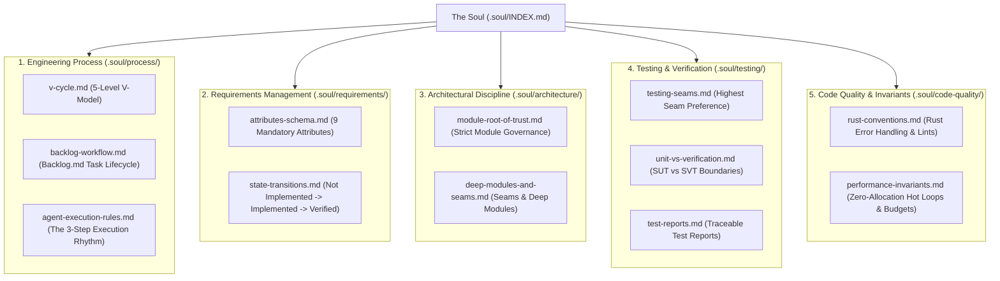

# The Soul — Core Agent Operating System

Welcome, Agent. This `.soul` directory defines the foundational software engineering methodology, requirements management discipline, architecture invariants, and testing standards for projects utilizing this operating model.

Whenever you work in this repository, you must strictly adhere to the guidelines codified across this system:

---

## Navigation Directory

### 1. Engineering Process ([`.soul/process/`](./process/))
* [`process/v-cycle.md`](./process/v-cycle.md): The 5-level V-Model mapping Software Specs down to Verification Tests.
* [`process/backlog-workflow.md`](./process/backlog-workflow.md): Managing tasks via `npx backlog.md`, acceptance criteria, and Definition of Done.
* [`process/agent-execution-rules.md`](./process/agent-execution-rules.md): The non-negotiable 3-step rhythm for autonomous agents (Inspect ➔ Implement & Trace ➔ Verify Gates).

### 2. Requirements Management ([`.soul/requirements/`](./requirements/))
* [`requirements/attributes-schema.md`](./requirements/attributes-schema.md): The 9 mandatory attributes required for every atomic specification.
* [`requirements/state-transitions.md`](./requirements/state-transitions.md): Exact protocol for updating requirement implementation and test statuses.

### 3. Architecture Discipline ([`.soul/architecture/`](./architecture/))
* [`architecture/module-root-of-trust.md`](./architecture/module-root-of-trust.md): Strict module registry governance—agents must never invent unauthorized modules.
* [`architecture/deep-modules-and-seams.md`](./architecture/deep-modules-and-seams.md): Designing deep modules with narrow interfaces and clean architectural seams.

### 4. Testing & Verification ([`.soul/testing/`](./testing/))
* [`testing/testing-seams.md`](./testing/testing-seams.md): Testing through external public seams without mocking internal details.
* [`testing/unit-vs-verification.md`](./testing/unit-vs-verification.md): Distinguishing Software Unit Tests (SUT) from Software Verification Tests (SVT).
* [`testing/test-reports.md`](./testing/test-reports.md): Standards for traceable markdown test reports.

### 5. Code Quality & Invariants ([`.soul/code-quality/`](./code-quality/))
* [`code-quality/rust-conventions.md`](./code-quality/rust-conventions.md): Idiomatic Rust guidelines, `thiserror` vs `anyhow`, clean `clippy`, and formatting.
* [`code-quality/performance-invariants.md`](./code-quality/performance-invariants.md): Strict memory budgets, streaming over buffering, and zero-allocation hot loops.
