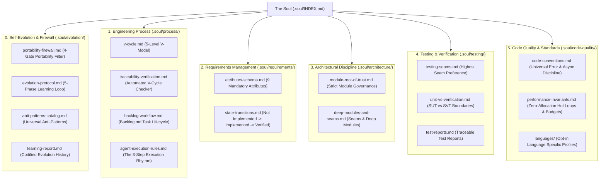

# The Soul — Core Agent Operating System

Welcome, Agent. This `.soul` directory defines the foundational, project-agnostic software engineering methodology, requirements management discipline, architectural invariants, testing standards, and self-evolution protocols.

**The Golden Law:** `.soul` is strictly portable. It actively rejects project-specific customizations, names, and assumptions. All project-specific context belongs in the host repository's `AGENTS.md` and `docs/`, never in `.soul`.

---

## Directory Navigation

### 0. Self-Evolution & The Portability Firewall ([`.soul/evolution/`](./evolution/))
* [`evolution/portability-firewall.md`](./evolution/portability-firewall.md): The core law defending `.soul` against project-specific leaks; defines the 4-Gate Portability Test.
* [`evolution/evolution-protocol.md`](./evolution/evolution-protocol.md): How `.soul` self-evolves across projects by detecting, distilling, and promoting new universal rules.
* [`evolution/anti-patterns-catalog.md`](./evolution/anti-patterns-catalog.md): Universal failure modes in process, architecture, testing, and code quality.
* [`evolution/learning-record.md`](./evolution/learning-record.md): The permanent audit trail of codified learnings and rule promotions.

### 1. Engineering Process ([`.soul/process/`](./process/))
* [`process/v-cycle.md`](./process/v-cycle.md): The 5-level V-Model mapping Software Specs down to Verification Tests.
* [`process/traceability-verification.md`](./process/traceability-verification.md): Automated V-Cycle verification, matrix generation, and CI gates ([`tools/v-cycle-checker.mjs`](./tools/v-cycle-checker.mjs)).
* [`process/backlog-workflow.md`](./process/backlog-workflow.md): Managing tasks via `npx backlog.md`, acceptance criteria, and Definition of Done.
* [`process/agent-execution-rules.md`](./process/agent-execution-rules.md): The non-negotiable 3-step rhythm for autonomous agents (Inspect ➔ Implement & Trace ➔ Verify Gates).

### 2. Requirements Management ([`.soul/requirements/`](./requirements/))
* [`requirements/attributes-schema.md`](./requirements/attributes-schema.md): The 9 mandatory attributes required for every atomic specification.
* [`requirements/state-transitions.md`](./requirements/state-transitions.md): Exact protocol for updating requirement implementation and test statuses.

### 3. Architecture Discipline ([`.soul/architecture/`](./architecture/))
* [`architecture/module-root-of-trust.md`](./architecture/module-root-of-trust.md): Strict module registry governance—agents must never invent unauthorized modules.
* [`architecture/deep-modules-and-seams.md`](./architecture/deep-modules-and-seams.md): Designing deep modules with narrow interfaces and clean architectural seams.

### 4. Testing & Verification ([`.soul/testing/`](./testing/))
* [`testing/testing-seams.md`](./testing/testing-seams.md): Testing through external public seams without mocking internal details.
* [`testing/unit-vs-verification.md`](./testing/unit-vs-verification.md): Distinguishing Software Unit Tests (SUT) from Software Verification Tests (SVT).
* [`testing/test-reports.md`](./testing/test-reports.md): Standards for traceable markdown test reports.

### 5. Code Quality & Language Profiles ([`.soul/code-quality/`](./code-quality/) & [`.soul/languages/`](./languages/))
* [`code-quality/code-conventions.md`](./code-quality/code-conventions.md): Universal conventions for explicit error boundaries, lint gates, and async discipline.
* [`code-quality/performance-invariants.md`](./code-quality/performance-invariants.md): Strict memory budgets, streaming over buffering, and zero-allocation hot loops.
* [`languages/rust.md`](./languages/rust.md): Opt-in language profile for Rust conventions (`thiserror` vs `anyhow`, compiler gates).
