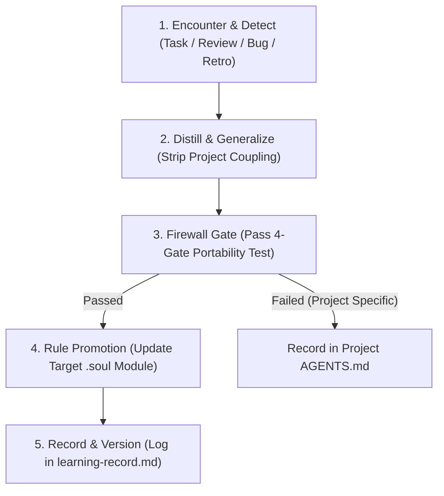

# Evolution: The Self-Evolving Learning Protocol

## 1. Overview
`.soul` is an evolving intelligence. As developers and AI agents build software, encounter bugs, discover architectural friction, or refine workflows, `.soul` actively learns. It captures high-value engineering lessons, distills them into universal standards, and permanently upgrades its own operating guidelines.

---

## 2. The 5-Phase Evolution Loop

### Phase 1: Encounter & Detect
Learning triggers whenever:
* A code review identifies a recurring anti-pattern (e.g., speculative helpers, fragile mocks).
* A bug or regression is diagnosed that could have been prevented by a structural process or architectural rule.
* A performance optimization reveals a reusable pattern for zero-allocation or memory safety.
* The human engineer explicitly states a new general standard (e.g., *"In my projects, I always want X"*).

### Phase 2: Distill & Generalize
The agent or developer isolates the root cause and strips away all project-specific names:
* **Raw Lesson:** *"Claude forgot to update the spec when adding a new CLI flag in agmux."*
* **Distilled Universal Standard:** *"Definition of Done requires updating requirement state attributes in the spec file before transitioning any backlog task to Done."*

### Phase 3: Firewall Gate
The distilled standard is evaluated against [`.soul/evolution/portability-firewall.md`](./portability-firewall.md):
* If it fails the firewall, it is placed in the project's local `AGENTS.md` or local architecture docs.
* If it passes all 4 gates, it proceeds to Phase 4.

### Phase 4: Rule Promotion
The standard is integrated into the appropriate `.soul` module:
* Engineering flow & tasks ➔ [`.soul/process/`](../process/)
* Requirements & traceability ➔ [`.soul/requirements/`](../requirements/)
* Structural boundaries & interfaces ➔ [`.soul/architecture/`](../architecture/)
* Testing & seams ➔ [`.soul/testing/`](../testing/)
* Universal code quality ➔ [`.soul/code-quality/`](../code-quality/)
* Reusable failure modes ➔ [`.soul/evolution/anti-patterns-catalog.md`](./anti-patterns-catalog.md)

### Phase 5: Record & Version
1. Append an entry to [`.soul/evolution/learning-record.md`](./learning-record.md) detailing:
   * **Date & Learning ID**
   * **Triggering Event / Context**
   * **General Principle Codified**
   * **Target File Updated**
2. The upgraded `.soul` is now immediately inherited by every subsequent task and can be copied/synced to other projects.
