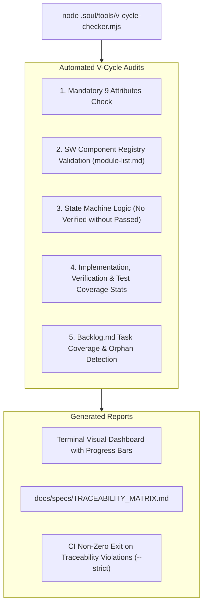

# Process: Traceability Verification & Gap Analysis

## 1. Overview
Requirements traceability cannot rely on human vigilance alone. The **V-Cycle Traceability Checker** ([`.soul/tools/v-cycle-checker.mjs`](../tools/v-cycle-checker.mjs)) is an automated, zero-dependency audit tool that continuously validates the integrity of the V-Cycle.

It scans all specification files, parses requirement attributes, checks component registration against the architecture, validates state transitions, and reports exact gaps.

---

## 2. Running the Traceability Checker

```bash
# 1. Run Standard Traceability & Gap Audit
node .soul/tools/v-cycle-checker.mjs

# 2. Run and Auto-Generate the Master Traceability Matrix
node .soul/tools/v-cycle-checker.mjs --generate-matrix

# 3. Strict Mode for CI / Pre-Push Gates (fails if any gap exists)
node .soul/tools/v-cycle-checker.mjs --strict
```

---

## 3. What the Checker Validates



1. **Mandatory Attributes:** Confirms that every atomic requirement declares all 9 mandatory fields (`Unique ID`, `Text`, `Criticality`, `SW Component`, `Implementation Status`, `Verification Criteria`, `Downstream Req`, `Downstream Test`, `Test Status`).
2. **Component Integrity:** Verifies that every `SW Component` maps to an officially registered crate/module in `docs/archi/module-list.md`.
3. **State Machine Integrity:** Prohibits illegal states, such as:
   * Marking a requirement `Verified` when `Test Status` is still `Failed`.
   * Marking a requirement `Not implemented` when `Test Status` is `Passed`.
4. **Coverage Metrics:** Computes the exact Implementation Rate, Verification Rate, and Test Pass Rate across the project.
5. **Backlog Coverage:** Validates that specifications are linked to active tasks in `backlog/tasks/`.

---

## 4. CI / CD Quality Gate
In production projects, `node .soul/tools/v-cycle-checker.mjs --strict` should be configured as a pre-commit or CI workflow step:
* If an agent marks a requirement `Verified` without a passing test, the build is blocked.
* If an agent invents an unregistered component, the build is blocked.
* If a requirement is missing mandatory fields, the build is blocked.
