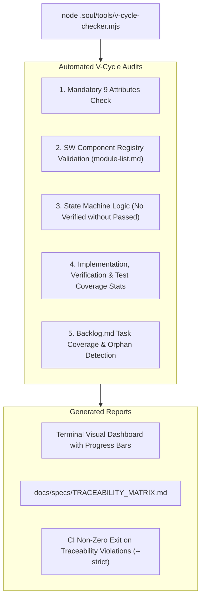

# Process: Traceability Verification & Gap Analysis

## 1. Overview
Requirements traceability cannot rely on human vigilance alone. The **V-Cycle Traceability Checker** ([`.soul/tools/v-cycle-checker.mjs`](../tools/v-cycle-checker.mjs)) is an automated, zero-dependency audit tool that continuously validates the integrity of the V-Cycle.

It scans all specification files, parses requirement attributes, checks component registration against the architecture, validates state transitions, and reports exact gaps.

---

## 2. Running the Traceability Checker

```bash
# 1. Run Standard Terminal Audit
node .soul/tools/v-cycle-checker.mjs

# 2. Generate Interactive Self-Contained HTML Dashboard
node .soul/tools/v-cycle-checker.mjs --html

# 3. Generate Both Markdown Matrix and Interactive HTML Dashboard
node .soul/tools/v-cycle-checker.mjs --html --generate-matrix

# 4. Strict Mode for CI / Pre-Push Gates (fails if any gap exists)
node .soul/tools/v-cycle-checker.mjs --strict
```

---

## 3. Interactive HTML Dashboard Capabilities (`--html`)
When executed with `--html`, the checker compiles a self-contained, offline-ready single-file dashboard (`docs/specs/traceability_report.html`) featuring:
* **Real-Time KPI Cards:** Visual animated progress bars for Implementation, Verification, and Test Pass rates.
* **Instant Multi-Factor Filtering:** Live search input coupled with dropdown filters for Criticality, Implementation Status, Test Status, and Specification Domain.
* **Gap Inspector Mode:** One-click *"Show Only Gaps"* toggle filtering immediately to unverified or failed requirements.
* **Collapsible Row Drawers:** Click any requirement row to expand and inspect its complete user-story text, verification criteria, and component ownership.
* **Offline Portability & Export:** Zero external CDNs or network dependencies; includes 1-click **Export CSV** and print/PDF media stylesheets.

---

## 3. What the Checker Validates



1. **Mandatory Attributes:** Confirms that every atomic requirement declares all 9 mandatory fields (`Unique ID`, `Text`, `Criticality`, `SW Component`, `Implementation Status`, `Verification Criteria`, `Downstream Req`, `Downstream Test`, `Test Status`).
2. **Component Integrity:** Verifies that every `SW Component` maps to an officially registered crate/module in `docs/archi/module-list.md`.
3. **State Machine Integrity:** Prohibits illegal states, such as:
   * Marking a requirement `Verified` when `Test Status` is still `Failed`.
   * Marking a requirement `Not implemented` when `Test Status` is `Passed`.
4. **Coverage Metrics:** Computes the exact Implementation Rate, Verification Rate, and Test Pass Rate across the project.
5. **Backlog Coverage:** Validates that specifications are linked to active tasks in `backlog/tasks/`.

## 4. Modular Extensibility Architecture

The `.soul` checker is structured as a modular plugin pipeline under `.soul/tools/`:

```
.soul/tools/
├── v-cycle-checker.mjs             # Main CLI entrypoint
└── lib/
    ├── parser.mjs                  # Parser for specs, module list, and backlog tasks
    ├── reporter-terminal.mjs       # Terminal dashboard & progress bars
    ├── reporter-markdown.mjs       # Markdown matrix generator (TRACEABILITY_MATRIX.md)
    ├── reporter-html.mjs           # Interactive self-contained HTML dashboard generator
    └── checks/                     # Pluggable rule checkers
        ├── index.mjs               # Check runner & active registry
        ├── mandatory-attributes.mjs# Rule: 9 mandatory attributes presence
        ├── allowed-values.mjs      # Rule: Criticality and status enums
        ├── state-machine-logic.mjs # Rule: State combination consistency
        ├── component-registry.mjs  # Rule: SW Component verification against module-list.md
        └── backlog-linkage.mjs     # Rule: Backlog task allocation audit
```

### Adding a New Verification Check
To add a new custom check (e.g. security level check, ADR compliance check, or copyright check), simply create a new file in `.soul/tools/lib/checks/my-check.mjs`:
```javascript
export const myCustomCheck = {
  id: 'CHECK-06-MY-CUSTOM-CHECK',
  name: 'My Custom Rule',
  description: 'Validates custom project invariant',
  run({ requirements, registeredComponents, backlogReferences }) {
    const errors = [];
    // Perform audit and push to errors array
    return errors;
  }
};
```
Then register it in `.soul/tools/lib/checks/index.mjs`.

### Adding a New Interactive Filter
In `.soul/tools/lib/reporter-html.mjs`, add a filter definition to `FilterRegistry`:
```javascript
{
  id: 'myCustomFilter',
  label: 'Custom Dimension',
  getValues: (items) => [...new Set(items.map(r => r.attributes['Custom Attribute']))].sort(),
  matches: (item, val) => val === 'ALL' || item.attributes['Custom Attribute'] === val
}
```
The HTML dashboard will dynamically render the new dropdown filter, bind real-time event listeners, and include it in CSV exports automatically with zero UI rewrites.

---

## 5. CI / CD Quality Gate
In production projects, `node .soul/tools/v-cycle-checker.mjs --strict` should be configured as a pre-commit or CI workflow step:
* If an agent marks a requirement `Verified` without a passing test, the build is blocked.
* If an agent invents an unregistered component, the build is blocked.
* If a requirement is missing mandatory fields, the build is blocked.
