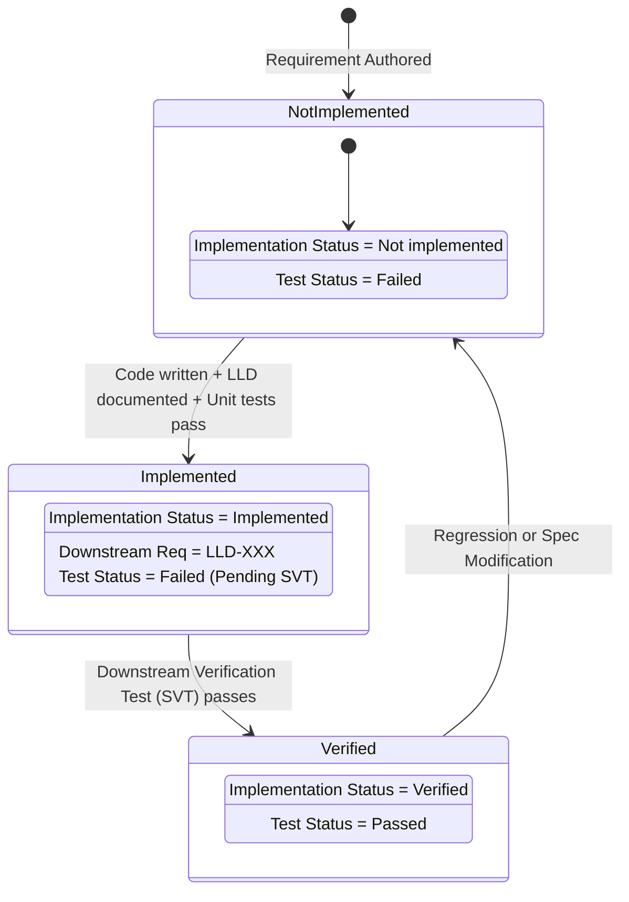

# Requirements: State Transition Lifecycle

## 1. Overview
Requirements must progress through a deterministic, irreversible-until-broken state machine. AI agents are responsible for updating these attributes in the specification markdown files as work advances.

---

## 2. State Transition Diagram

---

## 3. Transition Rules for AI Agents

1. **Rule 1 (Writing Implementation):** When an agent creates the code and writes the LLD document in `crates/<crate>/docs/<module>_lld.md`:
   * Change `Implementation Status: Not implemented` ➔ `Implemented`.
   * Fill in `Downstream Req: LLD-xxx-001`.
   * Keep `Test Status: Failed` until the verification test is executed.

2. **Rule 2 (Passing Verification Tests):** When the integration test suite in `tests/` passes:
   * Change `Implementation Status: Implemented` ➔ `Verified`.
   * Change `Test Status: Failed` ➔ `Passed`.

3. **Rule 3 (Atomic Commit Readiness):** A Pull Request or feature branch cannot merge if any requirement in scope remains in `Implemented` with `Test Status: Failed`.
