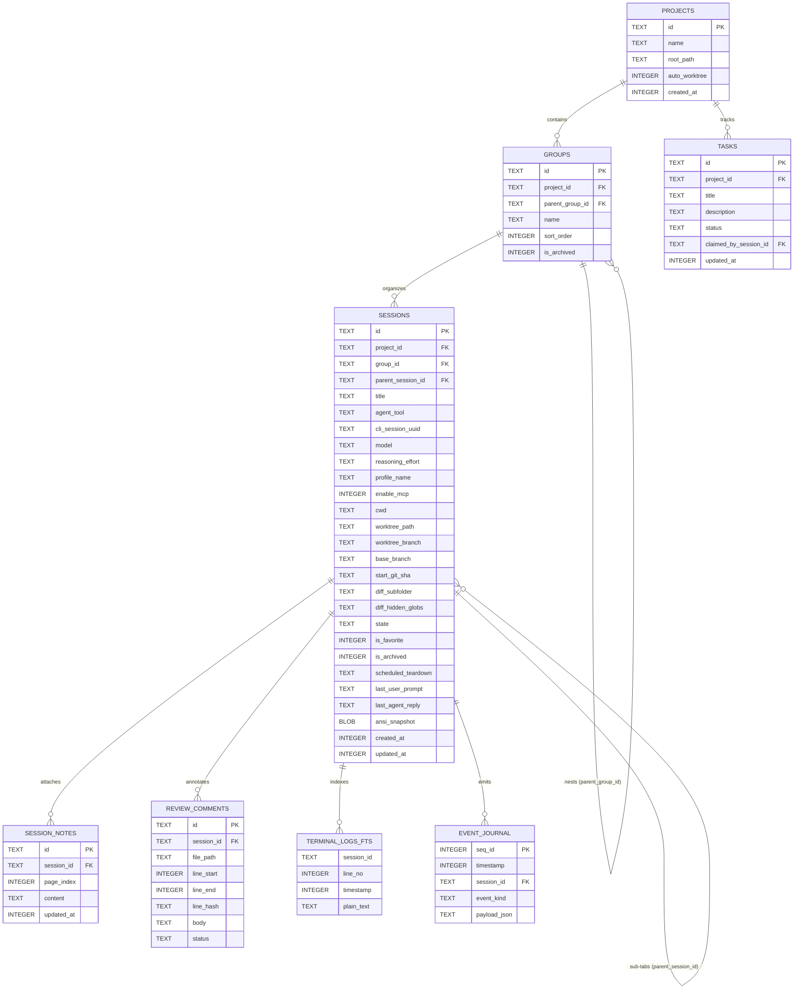

# Data Design & Storage Architecture — Agmux

## 1. Overview
The Agmux persistence layer is built around a single-writer SQLite database operating in Write-Ahead Logging (WAL) mode, paired with a trigram-tokenized FTS5 full-text search index and Zstandard-compressed ANSI scrollback blobs.

---

## 2. Entity-Relationship Diagram (ERD)



---

## 3. Detailed Data Schema

### 3.1 `projects`
Top-level project workspaces.
```sql
CREATE TABLE projects (
    id TEXT PRIMARY KEY,
    name TEXT NOT NULL,
    root_path TEXT NOT NULL,
    auto_worktree INTEGER NOT NULL DEFAULT 0,
    created_at INTEGER NOT NULL
);
```

### 3.2 `groups`
Hierarchical folders within a project.
```sql
CREATE TABLE groups (
    id TEXT PRIMARY KEY,
    project_id TEXT NOT NULL REFERENCES projects(id) ON DELETE CASCADE,
    parent_group_id TEXT REFERENCES groups(id) ON DELETE CASCADE,
    name TEXT NOT NULL,
    sort_order INTEGER NOT NULL DEFAULT 0,
    is_archived INTEGER NOT NULL DEFAULT 0
);
CREATE INDEX idx_groups_project ON groups(project_id);
```

### 3.3 `sessions`
Primary state records for agent instances and sub-tabs.
```sql
CREATE TABLE sessions (
    id TEXT PRIMARY KEY,
    project_id TEXT NOT NULL REFERENCES projects(id) ON DELETE CASCADE,
    group_id TEXT REFERENCES groups(id) ON DELETE SET NULL,
    parent_session_id TEXT REFERENCES sessions(id) ON DELETE CASCADE,
    title TEXT NOT NULL,
    agent_tool TEXT NOT NULL,
    cli_session_uuid TEXT,
    model TEXT,
    reasoning_effort TEXT,
    profile_name TEXT,
    enable_mcp INTEGER NOT NULL DEFAULT 0,
    cwd TEXT NOT NULL,
    worktree_path TEXT,
    worktree_branch TEXT,
    base_branch TEXT,
    start_git_sha TEXT,
    diff_subfolder TEXT,
    diff_hidden_globs TEXT,
    state TEXT NOT NULL DEFAULT 'IDLE',
    is_favorite INTEGER NOT NULL DEFAULT 0,
    is_archived INTEGER NOT NULL DEFAULT 0,
    scheduled_teardown TEXT,
    last_user_prompt TEXT,
    last_agent_reply TEXT,
    ansi_snapshot BLOB,
    created_at INTEGER NOT NULL,
    updated_at INTEGER NOT NULL
);
CREATE INDEX idx_sessions_state ON sessions(state);
CREATE INDEX idx_sessions_project ON sessions(project_id);
CREATE INDEX idx_sessions_parent ON sessions(parent_session_id);
```

### 3.4 `session_notes`
Multi-page scratchpad markdown notes.
```sql
CREATE TABLE session_notes (
    id TEXT PRIMARY KEY,
    session_id TEXT NOT NULL REFERENCES sessions(id) ON DELETE CASCADE,
    page_index INTEGER NOT NULL DEFAULT 0,
    content TEXT NOT NULL,
    updated_at INTEGER NOT NULL
);
CREATE INDEX idx_notes_session ON session_notes(session_id);
```

### 3.5 `terminal_logs_fts`
Trigram full-text search virtual table for instant search across all transcripts.
```sql
CREATE VIRTUAL TABLE terminal_logs_fts USING fts5(
    session_id UNINDEXED,
    line_no UNINDEXED,
    timestamp UNINDEXED,
    plain_text,
    tokenize = 'trigram'
);
```

### 3.6 `review_comments`
Line-level annotations for interactive code review (`Ctrl+R`).
```sql
CREATE TABLE review_comments (
    id TEXT PRIMARY KEY,
    session_id TEXT NOT NULL REFERENCES sessions(id) ON DELETE CASCADE,
    file_path TEXT NOT NULL,
    line_start INTEGER NOT NULL,
    line_end INTEGER NOT NULL,
    line_hash TEXT NOT NULL,
    body TEXT NOT NULL,
    status TEXT NOT NULL DEFAULT 'draft' CHECK(status IN ('draft', 'sent', 'resolved', 'outdated'))
);
CREATE INDEX idx_review_session ON review_comments(session_id);
```

### 3.7 `tasks`
Shared Kanban task board for multi-agent coordination.
```sql
CREATE TABLE tasks (
    id TEXT PRIMARY KEY,
    project_id TEXT NOT NULL REFERENCES projects(id) ON DELETE CASCADE,
    title TEXT NOT NULL,
    description TEXT,
    status TEXT NOT NULL DEFAULT 'open' CHECK(status IN ('open', 'claimed', 'done')),
    claimed_by_session_id TEXT REFERENCES sessions(id) ON DELETE SET NULL,
    updated_at INTEGER NOT NULL
);
CREATE INDEX idx_tasks_project ON tasks(project_id);
```

### 3.8 `event_journal`
Monotonic event log backing stateful cursor streaming (`agmux watch`).
```sql
CREATE TABLE event_journal (
    seq_id INTEGER PRIMARY KEY AUTOINCREMENT,
    timestamp INTEGER NOT NULL,
    session_id TEXT NOT NULL REFERENCES sessions(id) ON DELETE CASCADE,
    event_kind TEXT NOT NULL,
    payload_json TEXT NOT NULL
);
CREATE INDEX idx_event_session ON event_journal(session_id);
```

---

## 4. Storage Strategy & Performance Policies

### 4.1 Single-Writer Concurrency Policy
* Only the background daemon (`agmuxd`) maintains an open connection pool to `state.db`.
* Subcommands (`agmux task`, `agmux lock`, `agmux report`) are prevented from opening the file directly, routing their mutations over the IPC socket.
* Database connections configure `journal_mode = WAL`, `synchronous = NORMAL`, and `busy_timeout = 5000`.

### 4.2 Rolling FTS5 Retention Policy
* Terminal output stripped of ANSI codes is inserted in batches every 250ms.
* A rolling FIFO retention limit (default: 50,000 lines per session, configurable via `config.toml`) ensures that high-volume test outputs or compilation logs do not bloat SQLite disk usage beyond the target SLAs.
* When session line count exceeds the threshold, older lines are pruned during WAL checkpointing.

### 4.3 Dead-Session Zstandard Compression (0 MB RAM)
* When a session transitions to `DEAD`, its in-memory `vt100::Parser` structure is dumped via `screen.contents_formatted()`.
* The raw ANSI bytes are compressed using `zstd::encode_all(&bytes, 3)` and stored into `sessions.ansi_snapshot`.
* The parser and PTY master file descriptors are dropped immediately, reducing memory consumption to **0 MB active RAM** while preserving full colored scrollback for instant client inspection.
