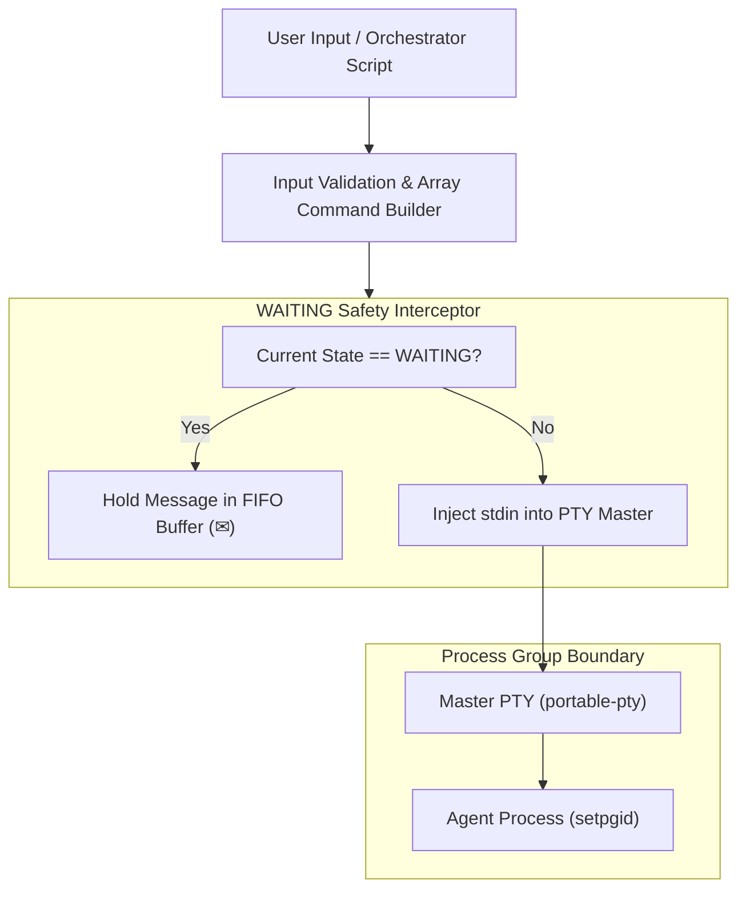

# Security Architecture — Agmux

## 1. Overview
The Agmux security architecture enforces strict local user boundaries, credential isolation, process containment, and transport authentication across both local IPC and remote federation topologies.

---

## 2. Authentication & Authorization Architecture

### 2.1 The `daemon.token` Authentication Scheme
Every running instance of `agmuxd` is secured by a cryptographically generated 256-bit token generated via OS CSPRNG (`getrandom` / `ring`) upon first launch.

```
+--------------------------------------------------------------------------------+
| Storage Location: ~/.local/share/agmux/daemon.token (or %LOCALAPPDATA%\agmux)  |
| File Permissions: 0600 (-rw-------, owner read/write only)                     |
| In-Memory Representation: [u8; 32] securely zeroized on drop                   |
+--------------------------------------------------------------------------------+
```

### 2.2 Transport Permissions Matrix

| Transport Mechanism | Scope | Access Control & Protection |
| :--- | :--- | :--- |
| **Unix Domain Socket** (`/run/user/$UID/agmuxd.sock`) | Local Linux/macOS/WSL | Protected by POSIX user permissions (`0600`), belonging exclusively to the executing user's UID. |
| **Windows Named Pipe** (`\\.\pipe\agmuxd-%USERNAME%`) | Local Windows | Protected by Win32 Discretionary Access Control Lists (DACLs) granting access only to the current user's SID. |
| **SSH Stdio Tunnel** (`ssh {host} agmuxd --stdio-proxy`) | Remote Federation | Inherits SSH public-key / certificate authentication; verified by internal `daemon.token` handshake. |
| **Tailscale Socket** (`mTLS TCP`) | Remote Mesh Network | Authenticated via Tailscale Machine Identity + TLS client certificates + `daemon.token` handshake. |

---

## 3. Data Protection & Encryption Standards

### 3.1 Data in Transit
* **Local Transports:** Unix Domain Sockets and Windows Named Pipes operate entirely within operating system kernel space; bytes never traverse external network interfaces.
* **Remote Transports:** All remote federation traffic is encapsulated within authenticated, encrypted SSH sessions (using AES-GCM / ChaCha20-Poly1305) or Tailscale WireGuard tunnels.

### 3.2 Data at Rest
* **SQLite Database (`state.db`):** Stored in user-restricted directory (`~/.local/share/agmux/` with mode `0700`).
* **Terminal Scrollback Snapshots:** Raw ANSI streams for dead sessions are compressed with Zstandard level 3 and stored directly as BLOBs within SQLite, preventing plaintext leakage in temporary file systems.
* **Zero Telemetry Guarantee:** Agmux contains zero telemetry, analytics beacons, or external reporting endpoints. No user prompt text or agent logs ever leave the user's machines.

---

## 4. Process Isolation & Injection Defense



### 4.1 Shell Injection Defense
* **Array-Based Process Execution:** Commands spawned via `agmux` (agents, Git worktree commands, shell sub-tabs) are passed as distinct argument vectors to `std::process::Command`, completely bypassing shell expansion (`sh -c` / `cmd.exe /c`) to prevent command injection vulnerabilities.
* **Notification Hook Safety Gate:** If the `hook_command` in `config.toml` is modified, `agmuxd` disables hook execution and displays a security confirmation banner in `agmux-tui` requiring explicit user approval before executing the updated shell command.

### 4.2 Security Interceptors
1. **Interactive Prompt Bypass Guard (`WAITING` Guard):** If an agent blocks on an interactive security confirmation (e.g. *"Allow deleting directory? [y/N]"*), any automated inter-agent messages (`agmux send`) are held in queue. The system strictly prohibits automated scripts from typing responses into security prompts.
2. **Worktree Destruction Safety Gate:** Prevents accidental deletion of uncommitted developer code by verifying working copy cleanliness and generating a safety backup `git stash` prior to worktree removal.
