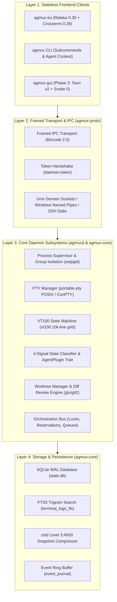
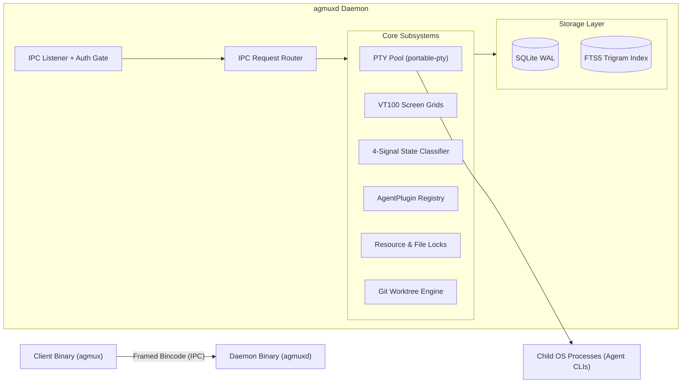
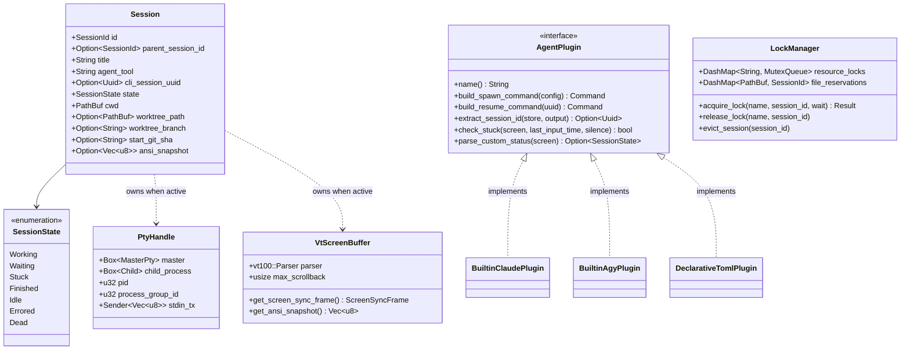

# Static Architecture — Agmux

## 1. System Overview & Scope
**Agmux** is a lightweight, cross-platform agentic terminal multiplexer and session orchestrator written in Rust. It utilizes a decoupled Client-Daemon topology where `agmuxd` directly manages OS pseudo-terminals and maintains in-memory terminal emulation state, while frontends (`agmux-tui`, `agmux-cli`, and `agmux-gui`) connect over a framed IPC transport.

---

## 2. Layered Architecture

---

## 3. High-Level Component Topology

---

## 4. Third-Party Integrations & Dependencies

| Crate / Library | Purpose in Agmux | Justification & Architectural Role |
| :--- | :--- | :--- |
| `portable-pty` | Pseudo-terminal allocation | Cross-platform abstraction over POSIX `openpty`/`forkpty` and Windows ConPTY without requiring external tools like tmux. |
| `vt100` / `libghostty-vt` | In-memory terminal parsing | Parses raw ANSI stream into a deterministic 2D character matrix and manages 10,000-line scrollback. |
| `ratatui` (0.30) + `crossterm` (0.29) | TUI client rendering | Modern, high-performance terminal UI renderer supporting mouse events, alternative screens, and sub-millisecond redraws. |
| `tui-term` | Terminal widget | Renders `vt100::Screen` instances directly inside Ratatui layout chunks. |
| `interprocess` | Local IPC transport | Fast, cross-platform Unix domain socket and Windows Named Pipe abstractions. |
| `bincode` (2.0) | IPC frame serialization | Zero-overhead binary serialization for client-daemon IPC frames. |
| `rusqlite` (bundled) | Single-writer storage | High-performance embedded SQLite database operating in WAL mode with trigram FTS5 extensions. |
| `zstd` | Dead-session compression | Compresses 10,000-line ANSI scrollback to <60 KB in <2ms, enabling 0 MB RAM dead sessions. |
| `gix` (gitoxide) / `git2` | Git operations | Pure-Rust Git worktree creation, branch checkout, `.worktreeinclude` handling, and hunk diffing. |
| `nucleo` | Fuzzy search engine | High-performance multithreaded fuzzy matching driving the Command Palette (`Ctrl+Shift+P`) and search modal. |
| `sysinfo` | Process tree inspection | Inspects child PID trees (cargo, git, npm, pytest) to maintain `WORKING` status during silent build phases. |
| `aho-corasick` | SIMD string matching | Multi-pattern terminal tail scanning for Braille spinners, limit banners, and blocked prompts. |
| `notify` | File watching | Hot-reloads `config.toml` and detects session store changes without daemon restarts. |

---

## 5. Core Domain Class & Struct Diagram

