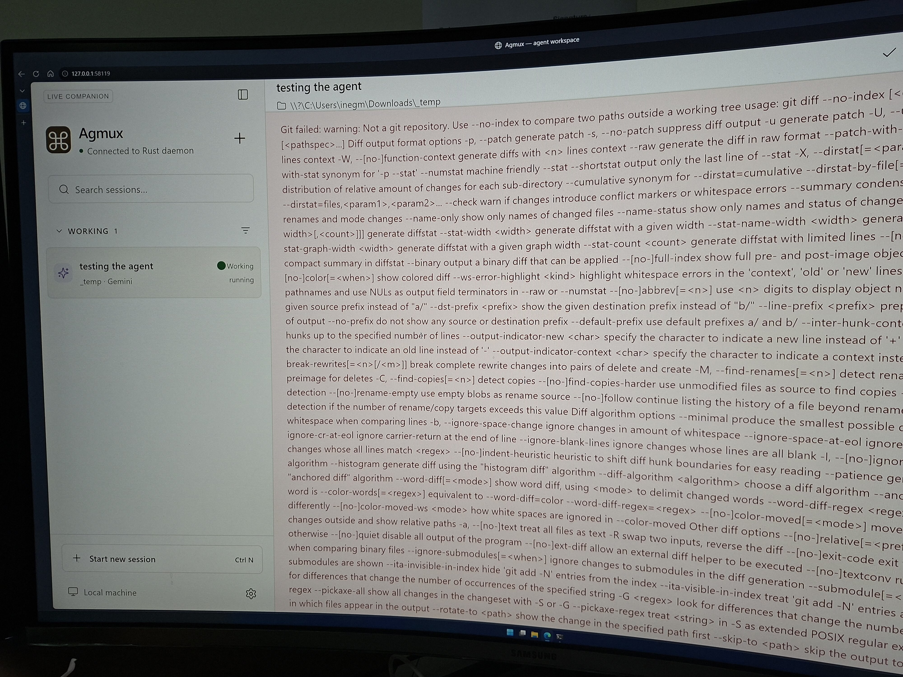
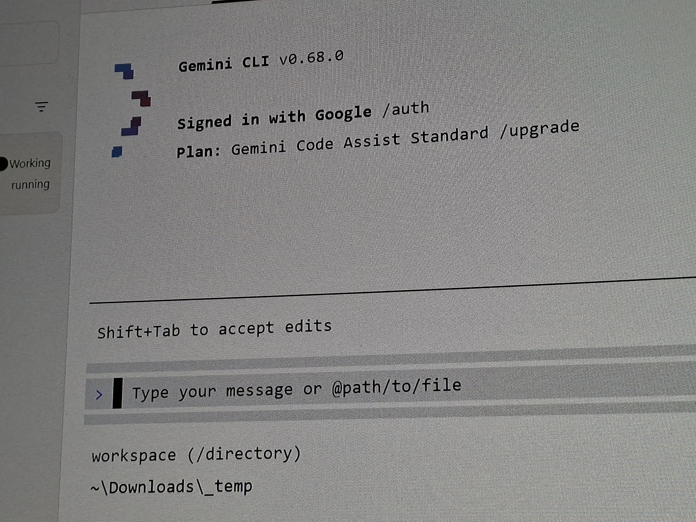
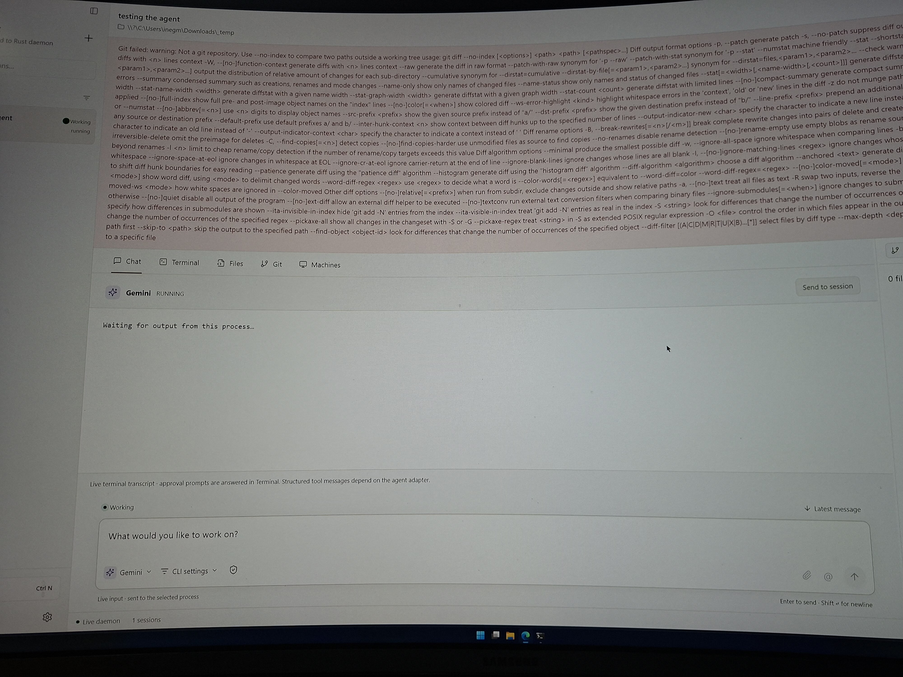
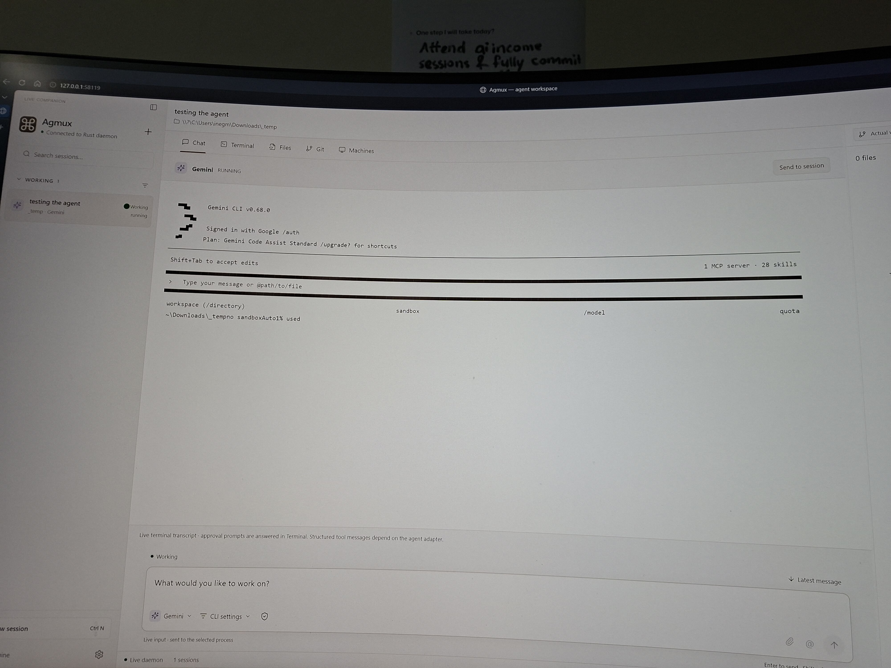
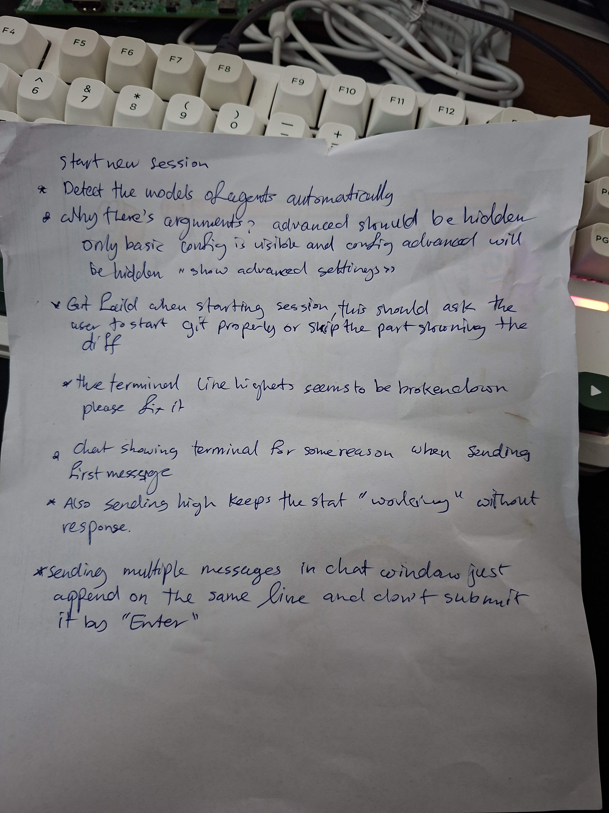

# Windows QA — user report batch 1

User-supplied photos reported on 2026-11-17 for the Agmux/Gemini Windows workspace.
These are report evidence, not proof that any item has been fixed.

JPEG copies preserve the full-resolution image content and orientation of the
original HEIC files. Embedded camera metadata is removed for browser compatibility.
No application source or release assets are changed by this evidence branch.

| Evidence | Original file | What it shows |
| --- | --- | --- |
| E1 | `1000064740.heic` | Git usage output overwhelms the workspace in a non-Git project folder. |
| E2 | `1000064741.heic` | Gemini CLI banner, signed-in state and terminal prompt/row rendering. |
| E3 | `1000064742.heic` | Large Git error above an empty Chat view; session labelled Working. |
| E4 | `1000064743.heic` | Native Gemini TUI appears inside the selected Chat tab. |
| E5 | `1000064744.heic` | Handwritten list of seven requested fixes, including failed message submission. |

## E1 — 1000064740.heic

## E2 — 1000064741.heic

## E3 — 1000064742.heic

## E4 — 1000064743.heic

## E5 — 1000064744.heic

